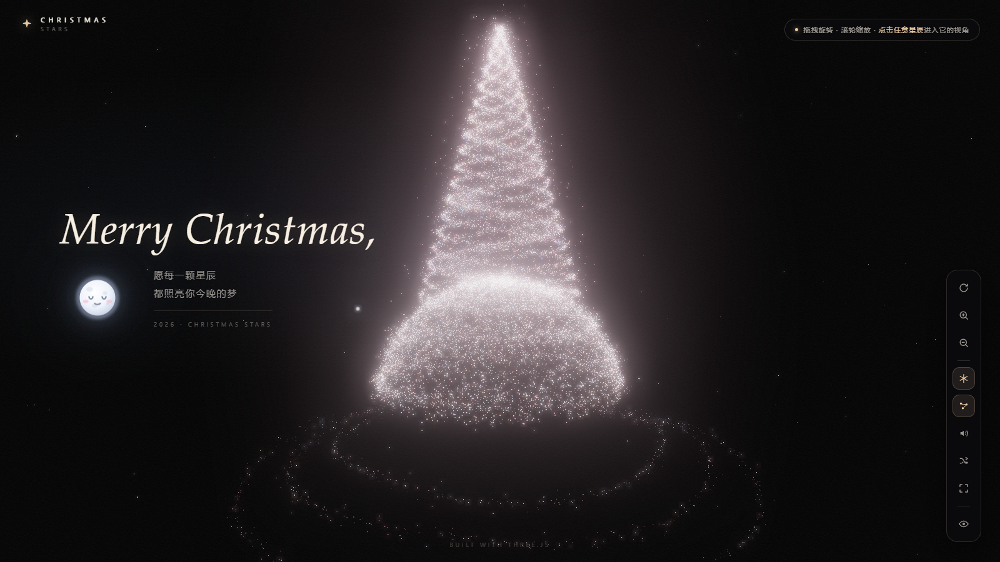

# Christmas Stars · 圣诞星辰

一个用 **Three.js** 制作的交互式圣诞主题页面。整个画面由 **约 3.6 万颗各自运行在独立轨道上的星辰** 构成 —— 圣诞树、星球穹顶、经纬光环、远景星海，全都由「有自己轨道、速度、相位的星辰」拼成。

成品是一个 **完全自包含的单文件 HTML**（Three.js 已内联打包，零外部请求），双击即可在浏览器中直接打开运行。



---

## 快速开始

```
christmas/
└─ index.html        ← 双击这个文件就能看（无需服务器、无需联网）
```

也可以拖到任意静态服务器上：`npx serve christmas` → `http://localhost:3000`。

---

## 交互说明

| 操作 | 效果 |
| --- | --- |
| **点击任意一颗星辰** | 镜头平滑飞入「该星辰的视角」，它会被光环锁定并生成星座连线 |
| 拖拽 | 环绕旋转（聚焦某颗星后可绕它旋转） |
| 滚轮 | 精细缩放；按住 `Shift` 进入 **超精细缩放**；触屏支持双指捏合 |
| `Esc` / `Space` | 返回全景 |
| `↑` `↓` / `+` `-` | 缩放 |
| `←` `→` | 左右旋转 |
| `S` | 开关飘雪 |
| `L` | 开关星辰连线 |
| `M` | 开关音效（选中星辰时的风铃） |
| `F` | 全屏 |
| `R` | 换一片星空（重新生成随机星场） |
| `H` | 隐藏 / 显示界面（适合纯净截图） |
| `P` | 显示 FPS 与星辰数量 |

---

## 视觉与特效

- **星辰轨道系统**：每颗星拥有独立的轨道轴、半径、角速度与相位，在 GPU 顶点着色器里实时求解位置；树上约 8% 是「狂野轨道」星，会明显地绕着树体游走，其余是微幅颤动，整体形状始终保持。
- **结构层次**：树冠螺旋（4 条主束 + 绒毛填充）→ 星球穹顶 → 球面漩涡 → 经纬光环 → 外侧横扫弧线 → 远景星海。
- **光影**：ACES Filmic 色调映射 + UnrealBloom 泛光，加性混合的粒子让每颗星自带光晕。
- **景深**：聚焦某颗星时，远离它的星辰会柔和虚化并淡出，形成散景；贴近镜头的粒子会被剔除，避免出现巨大光斑并保证帧率。
- **氛围**：动态飘雪、鼠标视差、胶片颗粒、暗角、玻璃拟态控制面板、加载进度条。
- **音频**：WebAudio 实时合成的风铃（无音频文件），八度音阶随星辰序号变化。

## 工程要点

- **零依赖运行**：Three.js r160 与后处理管线经 esbuild 打包内联进单个 HTML，离线可用。
- **着色器驱动**：全部星辰用自定义 `ShaderMaterial` + `BufferGeometry`，3.6 万点仅 1 次 draw call。
- **拾取**：屏幕空间投影拾取（30 Hz），而不是射线求交 —— 3.6 万点也能瞬时命中。
- **相机装置**：球坐标机位 + 临界阻尼插值；进入 / 退出星辰视角使用 `easeInOutCubic` 缓动，并配合构图偏移把主体放在画面偏上位置。
- **自适应性能**：按设备自动选择 high / medium / low 三档画质（约 3.6 万 / 2.4 万 / 1.4 万颗星），帧率过低时自动降分辨率并减弱泛光。
- **画质覆盖**：URL 参数 `?quality=low|medium|high` 可强制指定。

---

## 源码结构

```
christmas/
├─ index.html          成品：单文件、零外部依赖
├─ build.mjs           构建脚本（esbuild CLI → 内联 → index.html）
├─ package.json
├─ src/
│  ├─ shell.html       页面骨架（DOM / SVG 月亮 / 工具栏 / 信息卡）
│  ├─ style.css        全部样式（暗色玻璃拟态 + 排版）
│  └─ main.js          Three.js 场景、轨道系统、拾取、相机、音效
└─ tools/
   └─ cdp.mjs          无头 Chromium 自动化验收（截图 + 模拟交互 + 断言）
```

### 重新构建

```bash
cd christmas
npm install          # 安装 three + esbuild
node build.mjs       # 生成 index.html
```

### 自动化验收

```bash
node tools/cdp.mjs --w=1600 --h=900 --tag=check --url="file:///D:/obo/christmas/index.html"
```

会启动无头 Chromium，加载页面，模拟悬停 / 点击星辰 / 滚轮缩放 / 拖拽 / 键盘返回，输出截图到 `shots/`，并对「点击是否进入星辰视角」「滚轮是否触发缩放」「Esc 是否回到全景」「控制台是否报错」等逐项断言。

---

*Made with Three.js · 愿每一颗星辰都照亮你今晚的梦*
